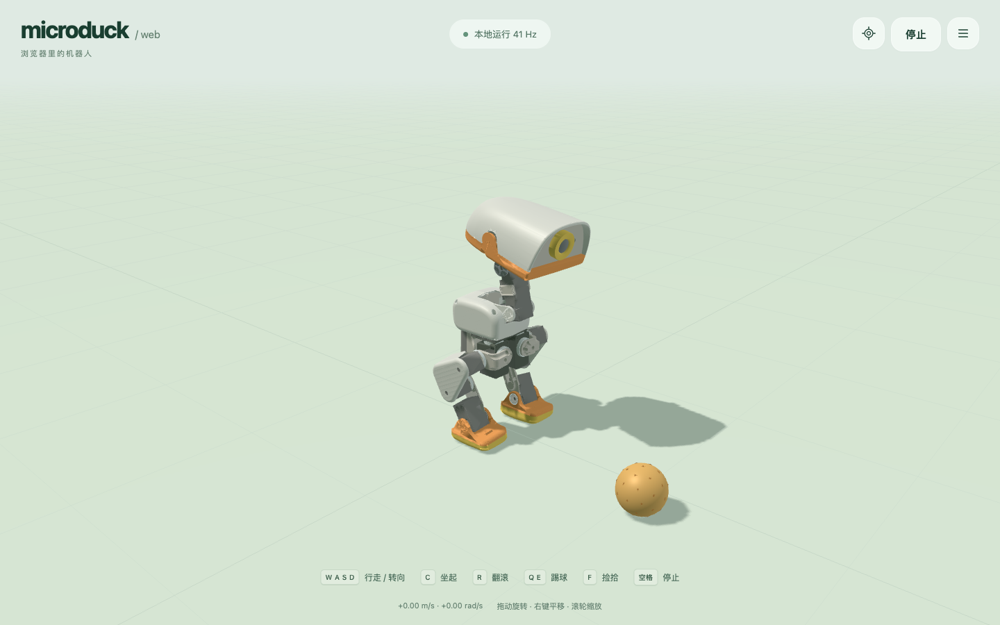
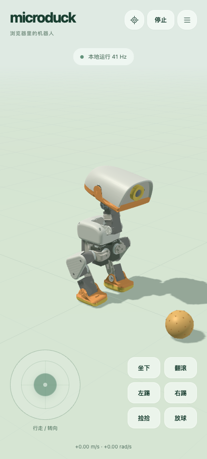
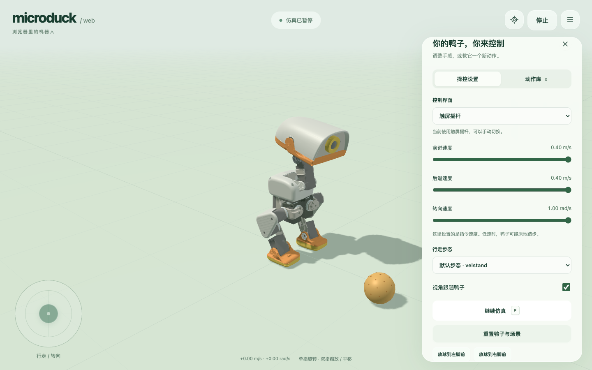
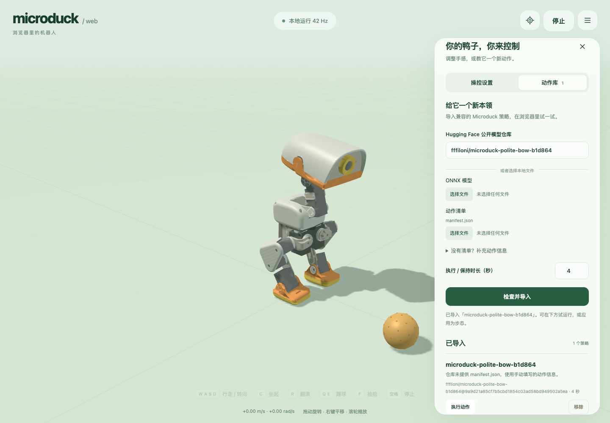

# Microduck Web

在浏览器里操控 Microduck。原始 MJCF / STL 机器人、MuJoCo 物理和 ONNX 运控策略都在本机运行，可部署为纯静态站点。



## 开始使用

需要 Node.js 22.12+（或 20.19+）。在此独立项目目录执行：

```sh
npm ci
npm run dev
```

打开终端显示的本地地址。首次需要下载机器人、八个内置策略与 WASM 引擎。当前发布目录约 74 MiB（未压缩），静态托管建议开启 gzip / Brotli。不要直接双击 `index.html`：Worker、资源请求和模块需要 HTTP(S)。

```sh
npm run build
npm run preview
```

`dist/` 是完整静态发布目录；不需要 Node 服务、Python 服务、登录或远程推理。生产环境使用 HTTPS；`localhost` 可用于本地测试。支持部署在域名下的子目录，例如 `/microduck/`。构建包含离线缓存，首次成功加载并完成后台缓存后可断网重新打开；浏览器清理站点数据会移除缓存与导入的模型。

## 操控

移动浏览器默认显示半透明摇杆与动作键，桌面默认键盘；菜单可切换“自动 / 触屏 / 键盘”，选择会保存。默认前进 **0.4 m/s**、后退 **0.4 m/s**、转弯 **1.0 rad/s**。这里是策略的指令值，实际运动速度由物理状态与策略决定。

| 操作 | 电脑 | 手机 |
| --- | --- | --- |
| 前后移动、左右转向 | WASD / 方向键 | 左侧摇杆 |
| 坐下 / 站起 | C | 坐起按钮 |
| 翻滚 | R | 翻滚按钮 |
| 左 / 右踢 | Q / E | 左踢 / 右踢 |
| 捡拾 | F | 捡拾按钮 |
| 放球到右脚前 | B | 放球按钮 |
| 暂停 / 继续 | P / 菜单 | 菜单 |
| 停止行走 | 空格 / 顶部停止 | 顶部停止 |
| 恢复视角 | 0 / 准星 | 准星 |
| 旋转 / 平移 / 缩放 | 拖动 / 右键拖动 / 滚轮 | 单指拖动 / 双指拖动 / 捏合 |

菜单另外提供左右脚前放球、速度、步态、跟随相机、重置场景、恢复默认值与动作库。球受真实接触力驱动；需要把球放到相应脚前再踢。停止清空移动指令，已经启动的动作会完成；暂停立即冻结仿真。失焦、切换输入模式、松开摇杆会清空移动，切到后台会暂停。

<p align="center"> </p>

## 导入社区新动作

菜单 → 动作库：选择本地 `.onnx` 与 `manifest.json`，或者输入公开 Hugging Face 模型仓库 `作者/仓库`。网页检查输入输出并实际试推理，成功后存入浏览器 IndexedDB；无需修改源码或重新打包。

- 一次性动作会新增“执行动作”；步态、站立、坐起和捡拾策略可应用到相应控制位置。
- 没有清单时，展开“补充动作信息”，手动设置名称、用途和时长。网络仓库没有清单时也使用这些设置；网页不能从权重猜出动作含义。
- 支持兼容的 MLP 与显式隐藏状态 LSTM ONNX。不是所有 RL checkpoint 都能直接使用；`.pt` 需要在训练项目中导出 ONNX。
- 具体接口、持续姿态、自定义指令、限制和示例见 [模型导入规范](docs/policy-import.md)。

已测试公开社区模型 [fffiloni/microduck-polite-bow-b1d864](https://huggingface.co/fffiloni/microduck-polite-bow-b1d864)：网页下载、导入、执行鞠躬、刷新恢复与移除。这个仓库没有 manifest，测试时采用一次性动作、4 秒；模型按下载时的提交 SHA 固定版本。



## 技术与验证

TypeScript / Vite、Three.js、MuJoCo 3.13.0 WASM、ONNX Runtime Web 1.30.0。50 Hz 控制，每次控制推进四个 5 ms 物理步；物理与推理在 Worker，主线程处理输入和绘制。设备性能不足时模拟时间会变慢，页面显示实测控制频率。

运控移植自原项目的 Rust 控制逻辑，保留 61 维观测、14 维动作、关节顺序、HOME、滤波、技能计时和增益切换。不是直接运行 Android 的 Rust 静态库；Web 的 MuJoCo 版本也与 Android 3.3.7 不同。实现与出处见 [架构](docs/architecture.md)、[第三方说明](THIRD_PARTY_NOTICES.md)。

```sh
npm test                    # 真实 WASM / ONNX + 控制器契约测试
npm run test:browser        # Chrome 桌面、触屏、动作、相机与设置保存
node scripts/qa-import.mjs  # 真实社区仓库导入回归，需要网络
node scripts/qa-static.mjs  # 生产子目录、离线缓存与移动端双指操作
```

浏览器脚本默认使用 macOS 已安装的 Google Chrome，可用 `CHROME_PATH` 指定其他 Chrome / Chromium 可执行文件；`QA_URL` 指定测试站点。浏览器测试会生成 `qa-output/` 与 README 截图。测试细节及复现步骤见 [验证记录](docs/validation.md)。

原始 RL 策略存在失稳边界，连续动作、碰撞、偏斜起姿可能导致倒地。默认不会强制把鸭子“动画扶正”；倒地后在菜单重置。它是本地仿真器，未连接或控制实体机器人。

## 项目布局

```text
src/input/        浏览器与触屏输入
src/simulation/   控制器、MuJoCo、Worker 和通信
src/policies/     ONNX、导入校验和 IndexedDB
src/render/       实际物理几何的 Three.js 渲染
public/           原始模型、八个策略、资源哈希
reference/        原控制器及接口文档快照
scripts/          构建、缓存和浏览器验证
```

这是与原 Microduck、Android 项目分开的 Git 仓库。Apache-2.0；第三方代码、机器人资源和模型的出处请见 [THIRD_PARTY_NOTICES.md](THIRD_PARTY_NOTICES.md)。本项目是移植作品，不代表 Pollen Robotics 官方产品。
